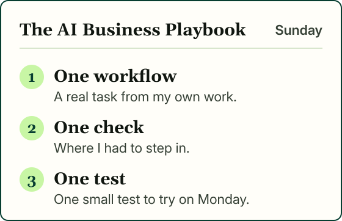

<picture>
  <source media="(prefers-color-scheme: dark)" srcset="assets/a-header-dark.svg">
  
</picture>

# Wyatt Brocato

**Technical Pro** · The AI Business Playbook · [wyattbrocato.site][website]

I write The AI Business Playbook, a free Sunday letter for mid-career professionals who use AI at work. Each issue takes about five minutes to read.

  <picture>
    <source media="(prefers-color-scheme: dark)" srcset="assets/a-letter-dark.svg">
    
  </picture>

**[Read the letters at wyattbrocato.site][website]**

## Try it on your own work

Both tools run in your browser, your answers stay there, and neither asks for an email to show your result.

- **[5-Task Swap][task-swap]:** four questions about one recurring task, then a plain verdict and a 15-minute test. About three minutes.
- **[AI Work Style quiz][workstyle]:** six questions that name your work style and your bottleneck.

## Built along the way

- **[design-and-copy-skills][design-and-copy-skills]:** 38 design and copywriting skills for AI coding agents. Each was tested against the same agent without it, and the losses and marginal results are disclosed.
- **[AI Deal Finder][deal-finder-live]:** search 390 product pages read in early October 2026. Each result shows the shelf price, when it was checked, and a coupon only when that product's own page printed one. The [source][deal-finder] is public.
- **[csm-kit][csm-kit]:** an offline Node.js CLI that turns CRM, ticket, and usage exports into renewal, handoff, and QBR briefs. Every factual line cites its source row.
- **[Scam First Aid][scam-first-aid]:** free, private help after a scam, with ordered steps and exact words to say. Nothing typed leaves the browser.
- **[Leverage Library][leverage-library]:** a sourced, cross-book idea library. Each idea is attributed, paraphrased, and flagged for confidence.

Also on [LinkedIn][linkedin] and [GitLab][gitlab].

[csm-demo]: https://wcbrocato.gitlab.io/csm-kit/demo/
[csm-kit]: https://github.com/thewyattbrocato/csm-kit
[deal-finder]: https://github.com/thewyattbrocato/ai-deal-finder
[design-and-copy-skills]: https://github.com/thewyattbrocato/design-and-copy-skills
[deal-finder-live]: https://thewyattbrocato.github.io/ai-deal-finder/
[gitlab]: https://gitlab.com/wcbrocato
[leverage-library]: https://thewyattbrocato.github.io/leverage-library-site/
[linkedin]: https://www.linkedin.com/in/wyattbrocato/
[scam-first-aid]: https://thewyattbrocato.github.io/scamfirstaid-site/
[task-swap]: https://thetaskswap.wyattbrocato.site/
[website]: https://wyattbrocato.site/
[workstyle]: https://workstyle.wyattbrocato.site/
