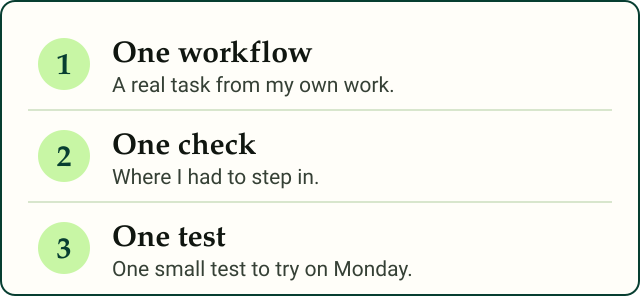

  <picture>
    <source media="(prefers-color-scheme: dark)" srcset="assets/profile-header-dark.svg">
    
  </picture>

# Wyatt Brocato

**A PM testing AI on real work.** I build practical AI work systems for experienced professionals: rough inputs become work you can stand behind, with context, risk, and approval staying human.

## Start here

**[wyattbrocato.site][website]** is the one link. It has my Sunday letter. Five minutes to read, free. Each one has three parts:

<picture>
  <source media="(prefers-color-scheme: dark)" srcset="assets/profile-format-dark.svg">
  
</picture>

Rather start with your own work? Both of these run in your browser, and your answers stay there.

- **[5-Task Swap][task-swap]**: four questions about one recurring task. You get a plain verdict and a 15-minute test. Three minutes, no email needed to see your result.
- **[AI Work Style quiz][workstyle]**: six questions. See your style and your bottleneck free, no email needed.

## Selected work

- **[AI Deal Finder][deal-finder-live]**: search store pages that were checked ahead of time. Each result shows the shelf price, a plain decision, and a coupon only when that product's own page printed one. It runs in the browser, and the [source][deal-finder] is public.
- **[csm-kit][csm-kit]**: an offline Node.js CLI that turns CRM, ticket, and usage exports into renewal, handoff, and QBR briefs. Every factual line cites its source row. Read a [generated renewal brief][csm-output] or try the [interactive demo][csm-demo].
- **[Scam First Aid][scam-first-aid]**: free, private help after a scam, with ordered steps, exact words to say, and family conversation scripts. Nothing typed leaves the browser. Its [public repository][scam-first-aid-repo] holds the reviewed static site, not the source.
- **[Leverage Library][leverage-library]**: a sourced, cross-book idea library. Each idea is attributed, paraphrased, and flagged for confidence. Its [public repository][leverage-library-repo] holds the reviewed static site, not the source.
- **AI Leverage Field Guide**: interactive, role-based workflow guides with local progress tracking and explicit human-review boundaries. Its [public repository][field-guide-repo] holds the reviewed static site; a live link is not yet verified.

## Now

- **Building:** AI Deal Finder. The live tool works today on stored, checked pages. Its agent skill, which returns one buy, wait, verify, or abstain decision, is still in validation, and no acceptance gate has passed yet.
- **Writing:** The AI Business Playbook, a weekly letter. Each issue is one workflow, one check, and one small test.
- **Focus:** practical systems for Customer Success, workflow design, and evidence-led decisions.
- **Point of view:** use automation for structure and repetition; keep context, risk, and approval human. Cite the source or mark the gap.

## Find me

**[wyattbrocato.site][website]** for the letter and the tools. Also on [LinkedIn][linkedin] and [GitLab][gitlab].

*Evidence before confidence. Build leverage.*

[csm-demo]: https://wcbrocato.gitlab.io/csm-kit/demo/
[csm-kit]: https://github.com/thewyattbrocato/csm-kit
[csm-output]: https://github.com/thewyattbrocato/csm-kit/blob/main/examples/example-renewal-brief.md
[deal-finder]: https://github.com/thewyattbrocato/ai-deal-finder
[deal-finder-live]: https://thewyattbrocato.github.io/ai-deal-finder/
[field-guide-repo]: https://github.com/thewyattbrocato/ai-leverage-field-guide-site
[gitlab]: https://gitlab.com/wcbrocato
[leverage-library]: https://thewyattbrocato.github.io/leverage-library-site/
[leverage-library-repo]: https://github.com/thewyattbrocato/leverage-library-site
[linkedin]: https://www.linkedin.com/in/wyattbrocato/
[scam-first-aid]: https://thewyattbrocato.github.io/scamfirstaid-site/
[scam-first-aid-repo]: https://github.com/thewyattbrocato/scamfirstaid-site
[task-swap]: https://thetaskswap.wyattbrocato.site/
[website]: https://wyattbrocato.site/
[workstyle]: https://workstyle.wyattbrocato.site/
